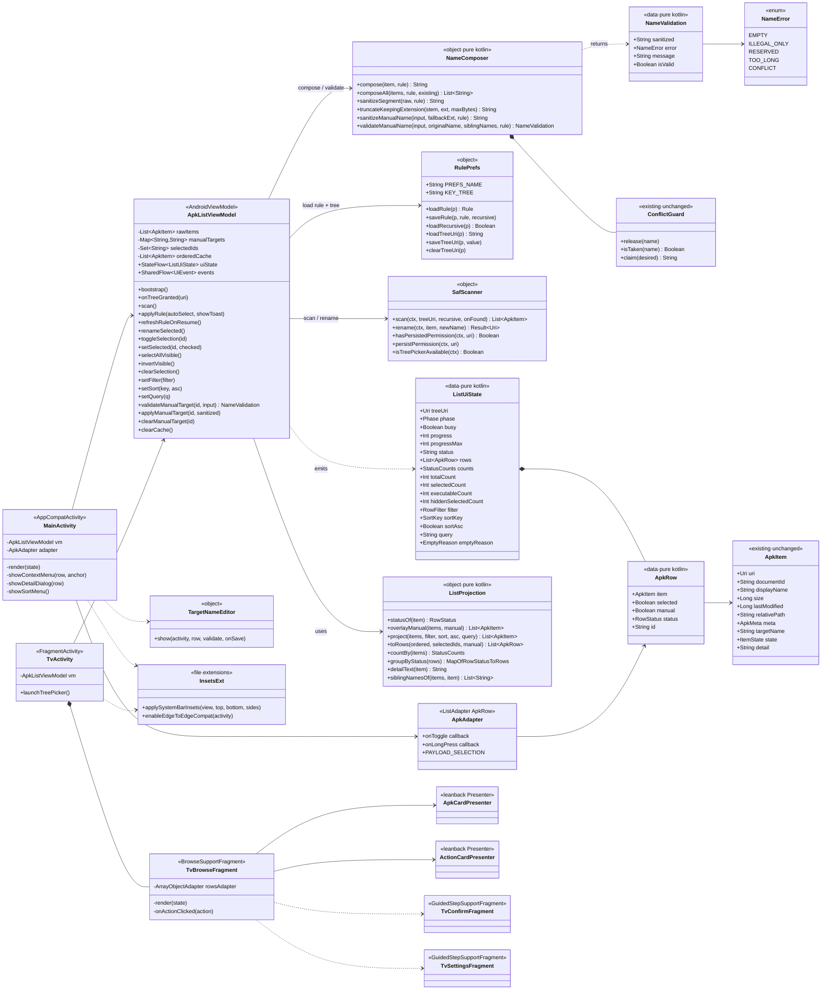
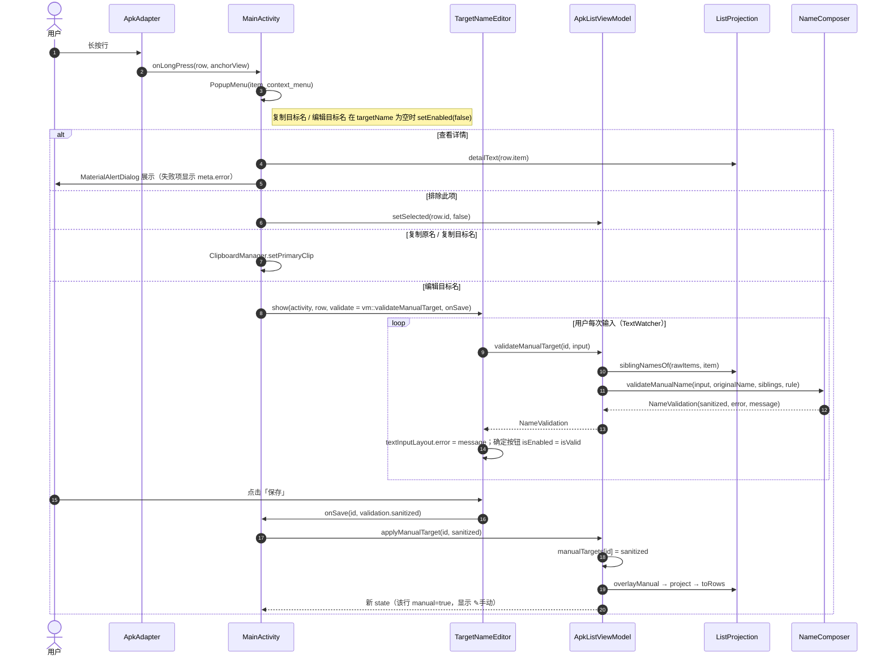
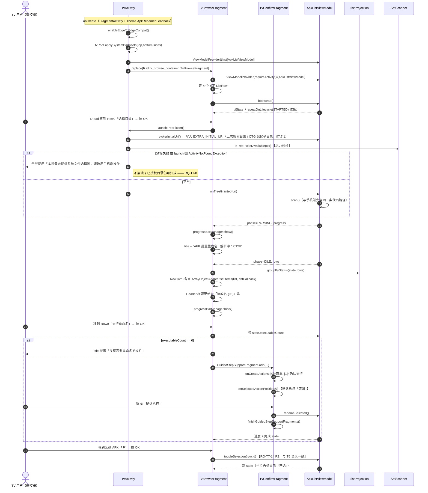
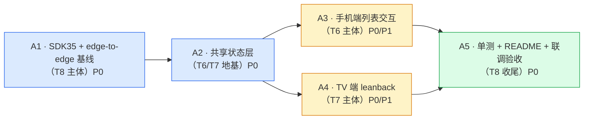

# ApkRenamer 增量系统设计 · P3

> **文档性质**：增量架构设计 + 任务分解。输入为 `docs/prd-incremental-p3.md`（v1.0）与现有代码基线。
> 只描述「相对当前已交付产品的变更」，未提及的模块一律保持原样。

| 项 | 值 |
|---|---|
| Language | 中文 |
| Programming Language | Kotlin（Android 原生，View + ViewBinding + Material3 + leanback） |
| Project Name | `apk_renamer` |
| 迭代批次 | P3（T6 列表交互增强 / T7 TV 布局 / T8 恢复 compileSdk 35） |
| 文档版本 | v1.0 |
| 架构师 | 高见远 |
| 关联文档 | `docs/prd-incremental-p3.md`、`README.md` |

---

## 〇、架构决策速览（先看这张表）

PRD §7 的 9 个待确认问题，本文档给出最终裁定。**工程师按此实现，不再回问。**

| # | 问题 | 裁定 | 理由 / 落地位置 |
|---|---|---|---|
| Q1 | 选中态存放位置 | **UI/状态层独立 `Set<String>`（key = `documentId`）** | `ApkItem` 保持纯净领域模型。归 `ApkListViewModel.selectedIds` 所有。`applyRule()` 用 `copy()` 重建列表不会影响它 |
| Q2 | 手动目标名是否跨扫描持久化 | **不持久化**，仅进程内会话有效 | 存于 `ApkListViewModel.manualTargets: Map<String,String>`。重新「扫描」时整表清空；「生成预览」/规则变更时**保留** |
| Q3 | 滑动手势 | **本期砍掉**（RQ-T6-13 顺延 P4） | 主理人已拍板。不引入 `ItemTouchHelper` |
| Q4 | leanback 版本 | **`androidx.leanback:leanback:1.0.0`** | 稳定版；`minSdk 21` 兼容；`BrowseSupportFragment` / `GuidedStepSupportFragment` 功能已足够 |
| Q5 | TV 是否允许执行重命名 | **允许**，但强制 `GuidedStepSupportFragment` 全屏二次确认，默认焦点「取消」 | 主理人已拍板。见 §4.3 |
| Q6 | TV 验收标准 | 最低线 = 编译通过 + 代码走查 + 静态布局检查；能起 TV AVD 再补截图 | 主理人已拍板 |
| Q7 | edge-to-edge 适配 | **本期一并修复**，且用**统一扩展函数**处理，不散落各 Activity | `ui/InsetsExt.kt`，见 §4.4 |
| Q8 | 是否引入 ViewModel | **引入 `ApkListViewModel : AndroidViewModel`**，无 DI 框架 | 手机端与 TV 端共用同一状态机与同一套扫描/解析/重命名编排，从根上满足 RQ-T7-6「TV 侧无重复业务实现」 |
| Q9 | 应用图标（RQ-T6-14 / RQ-T7-15） | **顺延 P4** | 主理人已拍板 |

### 本设计对红线的自检

| # | 红线 | 本设计如何保证 |
|---|---|---|
| R1 | 零 `uses-permission` | Manifest 只**移动** `LEANBACK_LAUNCHER` category、**新增** `TvActivity` 节点。权限区仍为空注释块。**也不新增 `<queries>`**（SAF 可用性判定改用 try/catch，见 §4.5） |
| R2 | 缓存 Key = SHA-256(URI\|lastModified\|size) | `ApkMetadataCache` / `ApkItem.cacheSeed` **零改动** |
| R3 | 解析失败不入缓存 | `MetaExtractor` **零改动** |
| R4 | 重命名成功元数据挂新 URI Key | `performRename` 的 `cache.put(cache.keyOf(renamed.cacheSeed), meta)` 逻辑**原样迁移**进 `ApkListViewModel.rename()`，不改语义 |
| R5 | `NameComposer` / `RulePrefs` 纯 Kotlin 可 JVM 单测 | 新增的 `sanitizeManualName()` / `validateManualName()` **只用 kotlin stdlib**，无任何 `android.*` import；`RulePrefs` 新增的常量与读写函数仍只依赖 `android.content.SharedPreferences`（测试用 `InMemorySharedPreferences` 实现）。相关**生产代码**保持零 `android.*` import；测试统一跑在 Robolectric 沙箱下（测试源集无 `android.net.Uri` 替身，Kotlin 测试直接 `Uri.parse` 构造真实 Uri，见 README 测试分层），Mockito 不引入 |
| R6 | 除 leanback 外零新增依赖 | 新增 artifact 仅 `androidx.leanback:leanback:1.0.0`（及其 AndroidX 传递依赖）。`lifecycle-viewmodel-ktx` 是**已在传递依赖图中**的 AndroidX 模块（`activity-ktx:1.9.2` 已 `api` 引入），本次只是显式声明并对齐版本，**不新增任何 artifact**。见 §6 |
| R7 | 手机端 Material3 视觉不变 | 主题 / 配色 / 卡片结构不动；T6 只在「状态文本 ↔ RecyclerView」之间插入两条新栏；edge-to-edge 修复的目标是「看起来与 targetSdk 34 一致」，见 §4.4 的状态栏保色方案 |

---

## 一、实现方案与框架选型

### 1.1 总体思路：先立地基，再铺两端

P3 的三项任务表面独立，实际存在一条硬依赖链：

```
T8（compileSdk 35 + edge-to-edge 基线）
        │  先把 Android 15 的窗口行为改动一次性吃掉
        ▼
共享状态层（ApkListViewModel + ListProjection + NameComposer 扩展）
        │  把「扫描/解析/预览/选中/筛选/排序/执行」全部收敛到一处
        ├──────────────┬──────────────┐
        ▼              ▼
   T6 手机端 UI     T7 TV 端 UI      ← 两端都退化为「渲染 + 派发意图」
```

**为什么 T8 必须最先做**：`targetSdk ≥ 35` 在 Android 15 上强制 edge-to-edge，系统不再为状态栏/导航栏预留空间。若先做 T7 再升 SDK，`MainActivity` / `SettingsActivity` / `TvActivity` 三套界面会**同时**出现遮挡回归，排查成本翻倍；先升 SDK 则只需修两个已知界面，`TvActivity` 从出生第一天就带着正确的 insets 处理写。

**为什么中间要插一层共享状态层**：RQ-T7-6 要求「TV 侧不得复制任何命名、扫描、缓存逻辑」。如果 TV 端自己写一遍 `startScan()` / `applyRule()` / `performRename()`，即使复用了 `SafScanner`/`MetaExtractor`，**编排逻辑仍然是复制的**——冲突消解的分组规则、缓存新 Key 的挂载时机、失败项的状态流转，任何一处两端写歧就是线上 Bug。引入一个不持有 View 的 `ApkListViewModel`，把这些编排收进 `viewModelScope`，两端 Activity 只剩「收集 `StateFlow` → 渲染」和「点击 → 调方法」，是成本最低的去重方案。

### 1.2 分层与职责

| 层 | 包 | 新旧 | 职责 | Android 依赖 |
|---|---|---|---|---|
| 领域模型 | `model/` | 旧·不改 | `ApkItem` / `ApkMeta` / `ItemState` | 仅 `android.net.Uri` |
| 核心能力 | `core/` | 旧·小改 | 命名合成与清洗、SAF 扫描/重命名、元数据抽取 | `NameComposer` 零依赖；其余需 `Context` |
| 缓存 | `cache/` | 旧·不改 | SHA-256 两级缓存 | `Context` |
| **共享状态** | **`vm/`** | **新** | 唯一状态源：扫描/解析/预览/选中/筛选/排序/手动改名/执行 | `AndroidViewModel`（只持 `Application`） |
| 手机 UI | `ui/` | 旧·大改 | RecyclerView 适配器、就地编辑弹窗、insets 扩展 | View / Material3 |
| **TV UI** | **`tv/`** | **新** | leanback `BrowseSupportFragment` + Presenter + GuidedStep | leanback |

> **关键约束**：`vm/` 内的三个文件中，`ListUiState.kt` 与 `ListProjection.kt` **必须零 `android.*` import**（`android.net.Uri` 经由 `ApkItem` 间接出现除外），以便 QA 直接写 JVM 单测；只有 `ApkListViewModel.kt` 允许触碰 `AndroidViewModel` / `Context`。

### 1.3 T6 状态管理方案

**问题**：`applyRule()` 用 `item.copy(...)` 重建整个列表，任何挂在对象上的 UI 状态都会丢；同时 1000 条列表下全选/反选必须 ≤16ms。

**方案**：单向数据流 + 投影缓存。

```
用户意图  ──▶  ApkListViewModel（可变源）
                 ├── rawItems: List<ApkItem>          扫描 + 规则计算的结果（唯一真相）
                 ├── manualTargets: Map<String,String> 手动目标名覆盖层
                 ├── selectedIds: Set<String>          选中集合（documentId 为键）
                 └── filter / sortKey / sortAsc / query
                        │
                        ▼  ListProjection.project()（纯函数）
                 orderedItems: List<ApkItem>   ← 叠加 manual → 筛选 → 排序（有缓存）
                        │
                        ▼  仅贴 selected 布尔位（O(n) map）
                 rows: List<ApkRow>  ──▶ StateFlow<ListUiState> ──▶ 两端 UI
```

**三个关键设计点**

1. **选中态与领域模型解耦**：`selectedIds` 只存 `documentId` 字符串。`applyRule()` 重建 `rawItems` 后，选中集合完好；只需做一次「剔除已不存在的 id」的清理。
2. **投影缓存避免重复排序**：`filter/sort/query/rawItems` 任一变化才重跑 `ListProjection.project()`；**仅 `selectedIds` 变化时复用 `orderedItems`，只重建 `rows` 的布尔位**。1000 条全选的开销是一次 `map`（微秒级），远低于 16ms 预算。
3. **DiffUtil payload**：`ApkAdapter` 从 `ListAdapter<ApkItem>` 改为 `ListAdapter<ApkRow>`。`getChangePayload()` 检测「只有 `selected` 不同」→ 返回 `PAYLOAD_SELECTION`，`onBindViewHolder(holder, position, payloads)` 只更新 CheckBox 与行底色，**不重建文本**。全程禁用 `notifyDataSetChanged()`。

**执行范围的精确定义（RQ-T6-3 与 RQ-T6-8 的冲突消解）**

PRD 一边说「执行范围严格等于用户可见的选中集合」（G1），一边说「筛选不改变选中集合内容，只改变可见性」（RQ-T6-8）。二者在「选中后又被筛选隐藏」时矛盾。裁定：

> **执行范围 = `selectedIds` ∩ `needsRename` ∩ `meta.isValid`，与当前筛选无关。**
> 但确认弹窗**必须**显示 `hiddenSelectedCount`：「其中 N 项当前被筛选条件隐藏」。

理由：筛选是"看"的工具，不是"选"的工具；静默丢弃用户已勾选的项比多一行提示更危险。`ListUiState.hiddenSelectedCount` 专为此字段存在。

### 1.4 T7 leanback 方案

| 决策点 | 选型 | 理由 |
|---|---|---|
| 依赖 | `androidx.leanback:leanback:1.0.0` | Q4 裁定。稳定版、`minSdk 21` 兼容 |
| Activity 基类 | **`androidx.fragment.app.FragmentActivity`**，**不是** `AppCompatActivity` | ⚠️ `Theme.Leanback` 继承自 `@android:style/Theme.Material`，不是 AppCompat 主题。`AppCompatActivity` + `Theme.Leanback` 会在 `onCreate` 抛 `IllegalStateException: You need to use a Theme.AppCompat theme`。`FragmentActivity` 同样是 `ComponentActivity` 子类，`registerForActivityResult` / `lifecycleScope` / `ViewModelProvider` 全部可用 |
| 主界面 | `BrowseSupportFragment` + Headers 侧栏 | leanback 原生 D-pad 导航，左侧 Header 天然承担「按状态分区」，比在 TV 上做筛选 Chips 更符合遥控器直觉 |
| 行结构 | Row0 操作 / Row1 待改名 / Row2 无需改 / Row3 已完成·失败 | 见 §4.3。**行数固定为 4**，空行保留但 Header 标题显示 `(0)`，避免行索引漂移导致焦点跳变 |
| 卡片 | 自定义 `BaseCardView` + `view_tv_apk_card.xml` | `ImageCardView` 是图片导向的，本产品无图（Q9 顺延），文字卡片自定义更省事且字号可控 |
| 二次确认 | `GuidedStepSupportFragment` | Q5 裁定，默认焦点「取消」 |
| TV 设置 | `GuidedStepSupportFragment`（`GuidedAction` 的 checkbox / radio / 数值步进） | 无软键盘输入；`自定义前缀` 用 `GuidedAction.Builder().enabled(false).focusable(false)` 做只读展示 |
| 进度反馈 | `BrowseSupportFragment.getProgressBarManager()` + 动态 `setTitle()` | leanback 自带，零额外布局；标题区形如 `APK 批量重命名 · 解析中 12/128` |
| 状态共享 | `ViewModelProvider(requireActivity())[ApkListViewModel::class.java]` | 不引 `fragment-ktx`（`by activityViewModels()` 需要它），保持依赖最小 |

**TV 端能力边界**（照抄 PRD §4.2 表，作为实现红线）：TV **不提供**单项目标名就地编辑、不提供自由文本输入、不提供长按菜单（以卡片点击后的动作替代）。

### 1.5 T8 SDK 升级方案

| 改动 | 内容 |
|---|---|
| `compileSdk` | `34` → `35`（本机 `android-35` 已确认存在） |
| `targetSdk` | `34` → `35` |
| 注释清理 | 删除 `build.gradle.kts` 第 8~9 行、第 16 行的临时降级说明 |
| README | 第 128 行改 35；**删除**第 133~135 行整段降级说明；第 129 行依赖描述补 leanback |
| **edge-to-edge 回归修复** | 见 §4.4，这是 T8 的真正工作量所在 |

---

## 二、文件列表

### 2.1 新增文件

| 相对路径 | 归属 | 说明 |
|---|---|---|
| `app/src/main/java/com/workbuddy/apkrenamer/vm/ListUiState.kt` | 共享 | `ListUiState` / `ApkRow` / `RowStatus` / `RowFilter` / `SortKey` / `StatusCounts` / `EmptyReason` / `UiEvent` / `Phase`。**纯 Kotlin** |
| `app/src/main/java/com/workbuddy/apkrenamer/vm/ListProjection.kt` | 共享 | 筛选 / 排序 / 分组 / 计数 / 详情文案。**纯 Kotlin，可 JVM 单测** |
| `app/src/main/java/com/workbuddy/apkrenamer/vm/ApkListViewModel.kt` | 共享 | 唯一状态源与流程编排（`AndroidViewModel`） |
| `app/src/main/java/com/workbuddy/apkrenamer/ui/InsetsExt.kt` | T8 | edge-to-edge 统一处理扩展函数 |
| `app/src/main/java/com/workbuddy/apkrenamer/ui/TargetNameEditor.kt` | T6 | 单项目标名就地编辑弹窗（Material） |
| `app/src/main/java/com/workbuddy/apkrenamer/tv/TvActivity.kt` | T7 | TV 入口（`FragmentActivity`） |
| `app/src/main/java/com/workbuddy/apkrenamer/tv/TvBrowseFragment.kt` | T7 | `BrowseSupportFragment` 主界面 |
| `app/src/main/java/com/workbuddy/apkrenamer/tv/TvAction.kt` | T7 | 操作行的动作模型（enum） |
| `app/src/main/java/com/workbuddy/apkrenamer/tv/ActionCardPresenter.kt` | T7 | 操作卡 Presenter |
| `app/src/main/java/com/workbuddy/apkrenamer/tv/ApkCardPresenter.kt` | T7 | APK 卡 Presenter |
| `app/src/main/java/com/workbuddy/apkrenamer/tv/TvConfirmFragment.kt` | T7 | `GuidedStepSupportFragment` 执行二次确认 |
| `app/src/main/java/com/workbuddy/apkrenamer/tv/TvSettingsFragment.kt` | T7·P1 | `GuidedStepSupportFragment` 精简设置页 |
| `app/src/main/res/layout/activity_tv.xml` | T7 | TV 容器（overscan 安全边距） |
| `app/src/main/res/layout/view_tv_apk_card.xml` | T7 | TV APK 卡片布局 |
| `app/src/main/res/layout/view_tv_action_card.xml` | T7 | TV 操作卡片布局 |
| `app/src/main/res/menu/item_context_menu.xml` | T6 | 长按上下文菜单 |
| `app/src/main/res/menu/sort_menu.xml` | T6 | 排序菜单 |
| `app/src/main/res/values/dimens.xml` | T7 | overscan 边距、TV 字号 |
| `app/src/main/res/values/themes_tv.xml` | T7 | `Theme.ApkRenamer.Leanback` 及其 GuidedStep 子主题 |
| `app/src/main/res/drawable/bg_tv_card.xml` | T7 | 卡片焦点态 selector |
| `app/src/main/res/drawable/bg_row_selected.xml` | T6 | 列表行选中底色 |
| `app/src/test/java/com/workbuddy/apkrenamer/core/NameComposerManualNameTest.kt` | T6 | 手动改名清洗/校验 JVM 单测 |
| `app/src/test/java/com/workbuddy/apkrenamer/vm/ListProjectionTest.kt` | T6 | 筛选/排序/分组 JVM 单测 |
| `app/src/main/java/com/workbuddy/apkrenamer/core/VolumeLogic.kt` | 新增 | docId 层面纯字符串卷运算（卷 ID / 子树判断 / 相对路径），零 Android 依赖 |
| `app/src/main/java/com/workbuddy/apkrenamer/core/PickerInitialResolver.kt` | 新增 | 目录选择器初始位置的三级取位纯决策（§7.7.1） |
| `app/src/test/java/com/workbuddy/apkrenamer/core/VolumeLogicTest.kt` | 新增 | 卷运算纯 JVM 单测（前缀碰撞 / 编码字面 / 卷 ID 大小写） |
| `app/src/test/java/com/workbuddy/apkrenamer/core/PickerInitialResolverTest.kt` | 新增 | 三级取位纯 JVM 单测（分支全覆盖 + 细边界） |
| `app/src/test/java/com/workbuddy/apkrenamer/vm/ApkListViewModelPickerTest.kt` | 新增 | `pickerInitialUri` 接线 Robolectric 单测（VM 状态 → 决策 → Uri，见 §7.7.1） |
| `app/src/test/java/com/workbuddy/apkrenamer/vm/ApkListViewModelSafTest.kt` | 新增 | `onTreeGranted` 持久化落盘 / `bootstrap`·`restoreFolder` 恢复与脏记录清理 Robolectric 单测 |
| `app/src/test/java/com/workbuddy/apkrenamer/RobolectricTestBase.kt` | 新增 | 全部单测共享的 Robolectric 基类（统一 runner + `@Config(sdk=[35])`，子类继承） |

### 2.2 修改文件

| 相对路径 | 归属 | 改动摘要 | 量级 |
|---|---|---|---|
| `app/build.gradle.kts` | T7/T8 | SDK 34→35、删降级注释、加 leanback + lifecycle-viewmodel-ktx | 小 |
| `app/src/main/AndroidManifest.xml` | T7 | `LEANBACK_LAUNCHER` 迁到新增的 `TvActivity`；**权限区仍为空** | 小 |
| `app/src/main/java/com/workbuddy/apkrenamer/core/NameComposer.kt` | T6 | 新增 `NameError` / `NameValidation` / `sanitizeManualName()` / `validateManualName()`。**保持零 Android 依赖** | 中 |
| `app/src/main/java/com/workbuddy/apkrenamer/core/RulePrefs.kt` | T6/T7 | 上收 `PREFS_NAME` / `KEY_TREE` 常量与目录读写函数，供两端与 Settings 共用 | 小 |
| `app/src/main/java/com/workbuddy/apkrenamer/core/SafScanner.kt` | T7 | 新增 `persistPermission()` / `isTreePickerAvailable()`，消除两端重复 | 小 |
| `app/src/main/java/com/workbuddy/apkrenamer/MainActivity.kt` | T6/T8 | 业务编排整体迁入 ViewModel，本类退化为渲染 + 事件派发；接入 insets | **大** |
| `app/src/main/java/com/workbuddy/apkrenamer/SettingsActivity.kt` | T8 | 接入 insets；`PREFS` 常量改引 `RulePrefs.PREFS_NAME` | 小 |
| `app/src/main/java/com/workbuddy/apkrenamer/ui/ApkAdapter.kt` | T6 | 泛型改 `ApkRow`；加 CheckBox / 点击 / 长按 / payload 局部刷新 / 手动标记 | **大** |
| `app/src/main/res/layout/activity_main.xml` | T6/T8 | 插入筛选条 + 批量操作条 + 空态文本；Toolbar 改 `wrap_content + minHeight`；底部条加 id | 中 |
| `app/src/main/res/layout/activity_settings.xml` | T8 | Toolbar 改 `wrap_content + minHeight`；`NestedScrollView` 补 id + `clipToPadding=false` | 小 |
| `app/src/main/res/layout/item_apk.xml` | T6 | 左侧加 CheckBox、目标名行加「✎手动」标记 | 小 |
| `app/src/main/res/values/strings.xml` | T6/T7 | 新增约 30 条文案 | 小 |
| `app/src/main/res/values/themes.xml` | T8 | 保留 `statusBarColor` 兼容旧版；补 `windowLightStatusBar` 等 | 小 |
| `README.md` | T7/T8 | SDK 版本、依赖清单、模块地图 | 中 |

### 2.3 明确「不动」的文件（防止过度重构）

`model/ApkItem.kt`、`cache/ApkMetadataCache.kt`、`core/MetaExtractor.kt`、`res/values/colors.xml`、
`res/menu/main_menu.xml`、`res/layout/item_chip_filter.xml`、`res/drawable/bg_badge.xml`、
现有 3 个测试文件与 2 个测试替身 —— **P3 全部零改动**。这直接保障了 R2 / R3 / R7。
（注：P3 之后的测试基础设施有变化——测试源集的 `android.net.Uri` 替身已删除，全部单测统一跑
Robolectric，见 README 测试分层；此处历史描述保留原样。）

---

## 三、数据结构与接口

### 3.1 类图



### 3.2 `vm/ListUiState.kt` — 状态与行模型

```kotlin
package com.workbuddy.apkrenamer.vm
// 纯 Kotlin：除 ApkItem 间接带入的 android.net.Uri 外，禁止任何 android.* import

/** 流程阶段，驱动进度条与按钮可用性 */
enum class Phase { IDLE, SCANNING, PARSING, RENAMING }

/** 行的展示状态，由 ApkItem 派生。TV 端按它分行，手机端按它筛选 */
enum class RowStatus(val label: String) {
    PENDING("待解析"), NEEDS_RENAME("待改名"), NO_CHANGE("无需改"),
    DONE("已完成"), FAILED("失败")
}

/** 筛选 Chips。ALL 为默认 */
enum class RowFilter { ALL, NEEDS_RENAME, NO_CHANGE, DONE, FAILED }

/** 排序维度 */
enum class SortKey { NAME, SIZE, TIME, STATUS }

/** 三种空态，文案互不相同（RQ-T6-11） */
enum class EmptyReason { NO_FOLDER, SCAN_EMPTY, FILTER_EMPTY }

data class StatusCounts(
    val all: Int = 0, val needsRename: Int = 0, val noChange: Int = 0,
    val done: Int = 0, val failed: Int = 0, val pending: Int = 0
)

/**
 * 列表行的 UI 模型。
 * @param item   已叠加手动目标名后的条目（下游只认 item.targetName，无需再判 manual）
 * @param manual 该项的目标名是否来自用户手动编辑（用于 ✎ 角标）
 */
data class ApkRow(
    val item: ApkItem,
    val selected: Boolean,
    val manual: Boolean,
    val status: RowStatus
) {
    val id: String get() = item.documentId
}

/** 一次性事件：Toast / 弹窗，不进 StateFlow 避免旋转后重放 */
sealed interface UiEvent {
    data class Toast(val text: String) : UiEvent
    data class RenameFinished(val success: Int, val failed: Int) : UiEvent
    object PickerUnavailable : UiEvent
}

data class ListUiState(
    val treeUri: Uri? = null,
    val phase: Phase = Phase.IDLE,
    val progress: Int = 0,
    val progressMax: Int = 0,
    val status: String = "",
    val rows: List<ApkRow> = emptyList(),      // 已筛选 + 已排序 + 已贴选中位
    val counts: StatusCounts = StatusCounts(),  // 基于全量，不受筛选影响
    val totalCount: Int = 0,
    val selectedCount: Int = 0,                 // 全局选中数
    val executableCount: Int = 0,               // 选中 ∧ needsRename ∧ meta.isValid
    val hiddenSelectedCount: Int = 0,           // 已选但被当前筛选隐藏
    val filter: RowFilter = RowFilter.ALL,
    val sortKey: SortKey = SortKey.NAME,
    val sortAsc: Boolean = true,
    val query: String = "",
    val emptyReason: EmptyReason? = null
) {
    val busy: Boolean get() = phase != Phase.IDLE
}
```

### 3.3 `vm/ListProjection.kt` — 纯函数投影层

| 函数 | 签名 | 说明 |
|---|---|---|
| `statusOf` | `(ApkItem) -> RowStatus` | `RENAMED→DONE`；`FAILED→FAILED`；`PENDING→PENDING`；否则 `needsRename ? NEEDS_RENAME : NO_CHANGE` |
| `overlayManual` | `(List<ApkItem>, Map<String,String>) -> List<ApkItem>` | 把手动目标名 `copy(targetName=…)` 覆盖上去；同时把 `SKIPPED` 修正为 `PARSED`（手动名与原名不同则重新变成待改） |
| `project` | `(List<ApkItem>, RowFilter, SortKey, Boolean, String) -> List<ApkItem>` | 筛选（状态 ∩ 关键词）→ **稳定排序**（`sortedWith`） |
| `toRows` | `(List<ApkItem>, Set<String>, Map<String,String>) -> List<ApkRow>` | 只贴 `selected` / `manual` 布尔位，**O(n)**，选中变化时单独调用 |
| `countBy` | `(List<ApkItem>) -> StatusCounts` | 基于**全量**计数，供 Chips 显示 |
| `groupByStatus` | `(List<ApkRow>) -> Map<RowStatus, List<ApkRow>>` | **TV 专用**：Row1/2/3 的数据源 |
| `detailText` | `(ApkItem) -> String` | 「查看详情」文案（RQ-T6-6），两端共用 |
| `siblingNamesOf` | `(List<ApkItem>, ApkItem) -> List<String>` | 同 `relativePath` 下**其它**文件的「当前名 + 目标名」并集，供手动改名冲突校验 |

**排序细则**：`NAME` 按 `displayName.lowercase()`；`SIZE` 按 `size`；`TIME` 按 `lastModified`；`STATUS` 按 `RowStatus.ordinal`。`sortAsc=false` 时 `reversed()`。所有排序前先按 `documentId` 兜底二级排序，保证**结果确定**（避免同值项在两次投影中换位导致视觉抖动）。

**关键词匹配**：`displayName` 或 `meta?.packageName` 包含 `query`（`ignoreCase`）。`query` 为空时短路跳过。

### 3.4 `core/NameComposer.kt` 增量接口（R5 重点）

```kotlin
/** 手动改名的错误分类 */
enum class NameError { EMPTY, ILLEGAL_ONLY, RESERVED, TOO_LONG, CONFLICT }

/** 校验结果。message 为可直接展示的中文文案，UI 层不得自行拼错误提示 */
data class NameValidation(
    val sanitized: String,
    val error: NameError? = null,
    val message: String? = null
) { val isValid: Boolean get() = error == null }

/**
 * 手动输入的整名清洗（含扩展名）。与 compose() 共用 sanitizeSegment / RESERVED_NAMES /
 * truncateKeepingExtension，保证「手动名」与「规则名」遵循同一套文件系统安全规则。
 *
 * 与 compose() 的差异：不做 collapseSeparator（用户手输的连续分隔符是有意的），
 * 不做字段拼接，仅做「非法字符剔除 + 首尾点空格清理 + 扩展名补齐/规范化」。
 */
fun sanitizeManualName(input: String, fallbackExt: String, rule: Rule): String

/**
 * 手动名完整校验。**不会**自动追加 _1 —— 冲突必须报错让用户改，静默改名是欺骗。
 *
 * @param originalName  该文件当前名，用于「与自身同名不算冲突」
 * @param siblingNames  同目录其它文件的当前名 + 目标名（由 ListProjection.siblingNamesOf 提供）
 */
fun validateManualName(
    input: String,
    originalName: String,
    siblingNames: Collection<String>,
    rule: Rule
): NameValidation
```

**校验顺序（实现时严格按此顺序，单测按此写用例）**

| 序 | 判定 | `NameError` | 文案 |
|---|---|---|---|
| 1 | `input.isBlank()` | `EMPTY` | 文件名不能为空 |
| 2 | 清洗后主干为空（全是非法字符） | `ILLEGAL_ONLY` | 文件名不能只包含非法字符 |
| 3 | 主干小写命中 `RESERVED_NAMES` | `RESERVED` | 该名称是系统保留名 |
| 4 | UTF-8 字节数 > `rule.maxByteLength` | `TOO_LONG` | 文件名过长（上限 N 字节） |
| 5 | 与 `siblingNames - originalName` 大小写不敏感撞名 | `CONFLICT` | 同目录下已存在同名文件 |
| — | 全部通过 | `null` | — |

> ⚠️ **R5 硬约束**：上述全部逻辑只允许使用 kotlin stdlib（`String` / `Regex` / `Charsets.UTF_8` / `Locale.ROOT`）。
> 大小写比较**必须**用 `Locale.ROOT`（土耳其语 `I` 问题）。QA 会为这 5 类错误各补至少 1 条 JVM 用例。

### 3.5 `core/RulePrefs.kt` 与 `core/SafScanner.kt` 增量

```kotlin
// RulePrefs：上收散落在 MainActivity / SettingsActivity 的私有常量，保证 RQ-T7-7「两端共用同一 SP」
const val PREFS_NAME = "apk_renamer_prefs"   // 值不变，仅换存放位置
const val KEY_TREE   = "tree_uri"            // 值不变
fun loadTreeUri(p: SharedPreferences): String?
fun saveTreeUri(p: SharedPreferences, value: String)
fun clearTreeUri(p: SharedPreferences)

// SafScanner：消除两端重复
fun persistPermission(context: Context, uri: Uri)          // 原 MainActivity.persistPermission 上移
fun isTreePickerAvailable(context: Context): Boolean       // 尽力而为的预检，真兜底仍是调用处 try/catch
```

### 3.6 `ApkListViewModel` 行为契约

| 方法 | 对 `selectedIds` 的影响 | 对 `manualTargets` 的影响 |
|---|---|---|
| `scan()` | **全清**，解析完成后自动全选所有 `needsRename`（PRD §5.1 默认行为） | **全清**（Q2：重新扫描即失效） |
| `applyRule(autoSelect=true)`（点「生成预览」） | 选中为空 → 全选 `needsRename`；否则保留并剔除失效 id | **保留**（RQ-T6-7 ③：不被规则覆盖） |
| `refreshRuleOnResume()`（从设置页返回） | **保留**并剔除失效 id | **保留** |
| `renameSelected()` 成功项 | **移出**选中集合 | **清除**该项手动名 |
| `renameSelected()` 失败项 | 保留选中，`state=FAILED` | 保留 |
| `setFilter/setSort/setQuery` | **不变**（RQ-T6-8） | 不变 |
| `selectAllVisible()` | 并入**当前 `rows`** 的全部 id（RQ-T6-2：只作用于筛选后可见集合） | 不变 |
| `invertVisible()` | 对当前 `rows` 的 id 做异或 | 不变 |
| `clearSelection()` | 清空**全部**（含被隐藏项） | 不变 |

### 3.7 `ApkAdapter` 增量契约

```kotlin
class ApkAdapter(
    private val onToggle: (String) -> Unit,
    private val onLongPress: (ApkRow, View) -> Unit
) : ListAdapter<ApkRow, ApkAdapter.VH>(DIFF) {
    companion object {
        const val PAYLOAD_SELECTION = "sel"
        private val DIFF = object : DiffUtil.ItemCallback<ApkRow>() {
            override fun areItemsTheSame(o: ApkRow, n: ApkRow) = o.id == n.id
            override fun areContentsTheSame(o: ApkRow, n: ApkRow) = o == n
            override fun getChangePayload(o: ApkRow, n: ApkRow): Any? =
                if (o.copy(selected = n.selected) == n) PAYLOAD_SELECTION else null
        }
    }
}
```

- `onBindViewHolder(holder, position, payloads)`：`payloads` 含 `PAYLOAD_SELECTION` 时**只**更新 `checkBox.isChecked` 与 `root.setBackgroundResource(...)`，直接 `return`。
- 行点击与 CheckBox 点击都走 `onToggle(row.id)`；CheckBox 设 `isClickable=false` + `isFocusable=false`，**由行统一拦截**，避免双回调。
- 长按返回 `true`，**不**触发选中切换（RQ-T6-5）。
- 手动标记：`tvManual.isVisible = row.manual`（显示 `✎手动`）。

### 3.8 TV Presenter / Row 结构

| 元素 | 类型 | 内容 |
|---|---|---|
| `rowsAdapter` | `ArrayObjectAdapter(ListRowPresenter())` | 固定 4 行，索引恒定 |
| Row 0 | `ListRow(HeaderItem(0,"操作"), ArrayObjectAdapter(ActionCardPresenter()))` | `TvAction` 五项 |
| Row 1 | `ListRow(HeaderItem(1,"待改名 (N)"), ArrayObjectAdapter(ApkCardPresenter()))` | `groupByStatus[NEEDS_RENAME]` |
| Row 2 | `ListRow(HeaderItem(2,"无需改动 (N)"), …)` | `NO_CHANGE` + `PENDING` |
| Row 3 | `ListRow(HeaderItem(3,"已完成 / 失败 (N)"), …)` | `DONE` + `FAILED` |

```kotlin
enum class TvAction(val title: String, val iconRes: Int) {
    PICK_FOLDER("选择目录", R.drawable.ic_app_icon),
    RESCAN("重新扫描", R.drawable.ic_app_icon),
    PREVIEW("生成预览", R.drawable.ic_app_icon),
    EXECUTE("执行重命名", R.drawable.ic_app_icon),
    SETTINGS("设置", R.drawable.ic_app_icon)
}
```

> 图标沿用现有 `ic_app_icon`（Q9 顺延，本期不做图标资产）。工程师可按需补几个简单 vector，但**不得引入图标库**。

- `ApkCardPresenter.onCreateViewHolder`：`BaseCardView(context).apply { cardType = CARD_TYPE_MAIN_ONLY; isFocusable = true; isFocusableInTouchMode = true }`，内部 inflate `view_tv_apk_card.xml`。
- 焦点态：`setOnFocusChangeListener` 做 `1.0f → 1.08f` 的 `scaleX/scaleY` 动画 + 切换 `bg_tv_card.xml` 的描边（RQ-T7-5）。
- 字号：目标名 `28sp` 粗体（主要）、原名 `20sp` 灰色（次要）、状态角标 `18sp`，均 ≥ PRD 要求的正文 24sp 基线（正文=目标名）。
- 卡片尺寸：`480dp × 200dp`（1080p 下一屏约 3.5 张，留出「还有更多」的视觉暗示）。

---

## 四、程序调用流程

### 4.1 手机端主闭环：选目录 → 扫描 → 生成预览 → 选中 → 执行

```mermaid
sequenceDiagram
    autonumber
    actor U as 用户
    participant MA as MainActivity
    participant AD as ApkAdapter
    participant VM as ApkListViewModel
    participant RP as RulePrefs
    participant SS as SafScanner
    participant ME as MetaExtractor
    participant NC as NameComposer
    participant LP as ListProjection
    participant CA as ApkMetadataCache

    Note over MA: onCreate
    MA->>MA: enableEdgeToEdgeCompat()
    MA->>MA: toolbar.applySystemBarInsets(top=true)
    MA->>MA: bottomBar.applySystemBarInsets(bottom=true)
    MA->>VM: bootstrap()
    VM->>CA: warmUp()
    VM->>RP: loadTreeUri(prefs)
    VM->>SS: hasPersistedPermission(uri)
    VM-->>MA: uiState(treeUri, status="已恢复上次目录…")

    U->>MA: 点击「选择文件夹」
    MA->>MA: runCatching { folderPicker.launch(vm.pickerInitialUri()) }
    Note right of MA: EXTRA_INITIAL_URI：主存储回落上次授权目录；可移动卷直达 OTG 记忆子目录（§7.7.1）
    Note right of MA: catch ActivityNotFoundException → UiEvent.PickerUnavailable
    MA->>VM: onTreeGranted(uri)
    VM->>SS: persistPermission(ctx, uri)
    VM->>RP: saveTreeUri(prefs, uri)
    VM->>VM: scan()

    rect rgb(238,244,255)
    Note over VM,CA: scan()  —— 运行在 viewModelScope
    VM->>VM: phase = SCANNING, manualTargets.clear(), selectedIds.clear()
    VM->>RP: loadRecursive(prefs)
    VM->>SS: scan(app, treeUri, recursive) { n -> status="已发现 n 个" }
    SS-->>VM: List~ApkItem~
    VM->>VM: phase = PARSING
    VM->>ME: extractAll(app, items) { p -> progress=p.done }
    ME->>CA: get/put（命中则 fromCache=true；失败不入缓存 R3）
    ME-->>VM: List~ApkItem~ (meta 就绪)
    VM->>VM: applyRule(autoSelect=true, showToast=false)
    end

    rect rgb(240,250,240)
    Note over VM,NC: applyRule()  —— 按 relativePath 分组做冲突消解（原逻辑不变）
    VM->>RP: loadRule(prefs)
    loop 每个目录分组
        VM->>NC: ConflictGuard(group.displayName, separator)
        VM->>NC: guard.release(item.displayName)
        VM->>NC: guard.claim(compose(item, rule))
        NC-->>VM: targetName
    end
    VM->>VM: rawItems = 重建列表（copy）
    VM->>LP: overlayManual(rawItems, manualTargets)
    VM->>LP: countBy() / project(filter, sort, query)
    VM->>LP: toRows(ordered, selectedIds, manualTargets)
    VM-->>MA: StateFlow~ListUiState~ 发射
    end

    MA->>AD: submitList(state.rows)
    AD->>AD: DiffUtil 局部刷新
    MA->>MA: 渲染 Chips 计数 / 批量条 / 执行按钮文案「重命名选中 96 项」

    U->>AD: 点击某一行
    AD->>MA: onToggle(documentId)
    MA->>VM: toggleSelection(id)
    VM->>LP: toRows(orderedCache, selectedIds, manual)
    Note right of VM: 复用 orderedCache，不重跑 filter/sort
    VM-->>MA: 新 state
    MA->>AD: submitList(rows)
    AD->>AD: getChangePayload → PAYLOAD_SELECTION（只刷 CheckBox + 底色）

    U->>MA: 点击「执行」
    MA->>VM: 读 state.executableCount / hiddenSelectedCount
    MA->>U: MaterialAlertDialog「将对 N 个文件执行… 其中 M 项被筛选隐藏」
    U->>MA: 确认
    MA->>VM: renameSelected()

    rect rgb(255,245,238)
    Note over VM,CA: renameSelected()
    VM->>VM: targets = selectedIds ∩ needsRename ∩ meta.isValid
    loop 逐个执行
        VM->>SS: rename(app, item, targetName)
        SS-->>VM: Result~Uri~
        alt 成功
            VM->>CA: put(keyOf(renamed.cacheSeed), meta) 【R4】
            VM->>VM: selectedIds -= id; manualTargets -= id; state = RENAMED
        else 失败
            VM->>VM: state = FAILED, detail = e.message
        end
        VM-->>MA: 进度 state
    end
    VM->>CA: flush()
    VM-->>MA: UiEvent.RenameFinished(success, failed)
    end
```

### 4.2 手机端支线：长按菜单 / 就地编辑目标名（RQ-T6-5 / RQ-T6-7）



> **R5 落点**：清洗与冲突校验全部发生在 `NameComposer`（纯 Kotlin）。`TargetNameEditor` **只负责**把 `NameValidation.message` 塞进 `TextInputLayout.error`、把 `isValid` 绑到确定按钮的 `isEnabled`。**UI 层出现任何 `replace('/', …)`、`ILLEGAL_CHARS` 遍历、`lowercase()` 撞名比较都是设计违规。**

### 4.3 TV 端闭环（D-pad）



**TV 端的三条实现纪律**

1. `TvBrowseFragment` 内**不得**出现 `SafScanner.scan` / `MetaExtractor` / `NameComposer.compose` / `ApkMetadataCache` 的直接调用——全部经 `ApkListViewModel`。唯一例外是 `TvActivity` 里的 `SafScanner.isTreePickerAvailable()`（属 UI 可用性判定，非业务逻辑）。
2. 行内数据更新用 `ArrayObjectAdapter.setItems(newList, diffCallback)`，**不要** `clear() + addAll()`——后者会丢焦点，遥控器体验直接崩。
3. 行数固定 4 行、索引恒定，空行也保留（Header 显示 `(0)`），避免行数变化导致焦点跳到别处。

### 4.4 edge-to-edge insets 处理（T8 核心）

**`ui/InsetsExt.kt` 契约**

```kotlin
/** 在 setContentView 之前/之后均可调用；统一关闭系统窗口自适配 */
fun ComponentActivity.enableEdgeToEdgeCompat() {
    WindowCompat.setDecorFitsSystemWindows(window, false)
}

/**
 * 把系统栏（含刘海）的 inset 以 padding 形式补给该 View。
 * 首次调用时记录 View 的初始 padding，后续每次 dispatch 都基于初始值累加，
 * 避免旋转/多次 dispatch 时 padding 累积膨胀。
 * 返回 insets 原样（不 CONSUMED），保证兄弟节点仍能拿到。
 */
fun View.applySystemBarInsets(
    top: Boolean = false,
    bottom: Boolean = false,
    sides: Boolean = true
)
```

实现要点：`ViewCompat.setOnApplyWindowInsetsListener` 中取
`insets.getInsets(WindowInsetsCompat.Type.systemBars() or WindowInsetsCompat.Type.displayCutout())`，
并在末尾 `ViewCompat.requestApplyInsets(this)` 触发首帧。

**逐界面应用点**

| 界面 | 目标 View | 参数 | 配套布局改动 |
|---|---|---|---|
| `MainActivity` | `binding.toolbar` | `top=true, sides=true` | ⚠️ Toolbar `layout_height` 由 `?attr/actionBarSize` 改为 `wrap_content` + `android:minHeight="?attr/actionBarSize"`，否则加了 top padding 会把标题压扁 |
| `MainActivity` | 底部按钮条（补 `android:id="@+id/bottomBar"`） | `bottom=true, sides=true` | 无 |
| `MainActivity` | `binding.recycler` | 不加 inset | 夹在两者之间，已被覆盖 |
| `SettingsActivity` | `binding.toolbar` | `top=true, sides=true` | 同上，改 `wrap_content + minHeight` |
| `SettingsActivity` | `NestedScrollView`（补 `android:id="@+id/scrollContent"`） | `bottom=true, sides=true` | 补 `android:clipToPadding="false"`，否则滚动内容会被 padding 裁掉 |
| `TvActivity` | `activity_tv.xml` 根容器 | `top/bottom/sides=true` | 与 overscan 边距**叠加**（初始 padding = overscan，inset 在其之上累加，正是 `applySystemBarInsets` 记录初始 padding 的用意） |

**视觉保真（R7）**：现有主题设了 `android:statusBarColor=@color/brand`，该属性在 API 35 上被忽略、状态栏强制透明。修复后 `MaterialToolbar`（背景 `@color/brand`）因为吃掉了 top inset 会**向上延伸到状态栏区域**，视觉结果仍是「品牌蓝顶栏」，与 targetSdk 34 时一致。`themes.xml` 中的 `statusBarColor` **保留**（API 34 及以下仍生效），不要删。

**为什么统一调 `enableEdgeToEdgeCompat()` 而不是只在 API 35 生效**：让 API 21~34 与 35+ 走**同一条渲染路径**，避免出现「Android 15 上对、Android 13 上错」这类只能靠真机才发现的分叉。代价仅是低版本设备上状态栏也变透明，而顶栏染色由 Toolbar 自身承担，观感不变。

---

## 五、任务列表（有序，含依赖）

### 5.1 实现顺序总览



**排序理由**

| 顺序 | 理由 |
|---|---|
| A1 最先 | PRD §4.3 明示「T8 应先于或并行于 T7」。先把 `targetSdk 35` 的 edge-to-edge 冲击在**两个已知界面**上吃掉，`TvActivity` 出生就带正确 insets；反之则要在三套界面上同时排查 |
| A2 次之 | A3 与 A4 都消费同一个 `ApkListViewModel`。先立地基，A3/A4 才可能**并行**且不打架 |
| A3 / A4 可并行 | 二者文件零重叠（`ui/`+`MainActivity` vs `tv/`+`Manifest`），仅共享 A2 的只读接口。单人串行则按 A3 → A4（手机端先跑通，等于给 ViewModel 做了一轮实战验证，TV 端接入风险更低） |
| A5 最后 | README 同时涉及 T7（依赖清单、模块地图）与 T8（SDK 版本），一次写完；单测需要 A2/A3 的最终接口定型 |

### 5.2 任务详情

---

#### **A1 · SDK 35 升级与 edge-to-edge 基线修复**

| 项 | 内容 |
|---|---|
| 优先级 | **P0** |
| 覆盖需求 | RQ-T8-1、RQ-T8-2、RQ-T8-3（部分）、RQ-T7-1（依赖声明） |
| 依赖 | 无 |
| 预估改动量 | ~180 行（新增 90 / 修改 90） |

**关联文件**

| 文件 | 动作 | 要点 |
|---|---|---|
| `app/build.gradle.kts` | 改 | `compileSdk`/`targetSdk` 34→35；删第 8~9、16 行降级注释；加 `androidx.leanback:leanback:1.0.0` 与 `androidx.lifecycle:lifecycle-viewmodel-ktx:2.8.6` |
| `app/src/main/java/.../ui/InsetsExt.kt` | **新增** | `enableEdgeToEdgeCompat()` + `View.applySystemBarInsets()`，见 §4.4 |
| `app/src/main/res/layout/activity_main.xml` | 改 | Toolbar → `wrap_content` + `minHeight`；底部条补 `@+id/bottomBar` |
| `app/src/main/res/layout/activity_settings.xml` | 改 | Toolbar 同上；`NestedScrollView` 补 `@+id/scrollContent` + `clipToPadding="false"` |
| `app/src/main/java/.../MainActivity.kt` | 改 | `onCreate` 接入 3 行 insets 调用（**本任务不动业务逻辑**，留给 A3） |
| `app/src/main/java/.../SettingsActivity.kt` | 改 | 同上 |
| `app/src/main/res/values/themes.xml` | 改 | 保留 `statusBarColor`；补 `<item name="android:enforceStatusBarContrast">false</item>`（`tools:targetApi="29"`）避免系统给透明状态栏加半透明遮罩 |

**完成判据**：`./gradlew :app:assembleDebug` 通过；`./gradlew :app:testDebugUnitTest` 全绿；Android 15 设备/模拟器上顶栏不被状态栏压住、底部按钮不被导航栏遮住。

---

#### **A2 · 共享状态层（ViewModel + 投影 + NameComposer 扩展）**

| 项 | 内容 |
|---|---|
| 优先级 | **P0** |
| 覆盖需求 | RQ-T6-3/4/8/9/10 的逻辑内核、RQ-T6-7 的校验内核、RQ-T7-6/7 |
| 依赖 | **A1** |
| 预估改动量 | ~700 行（新增 640 / 修改 60） |

**关联文件**

| 文件 | 动作 | 要点 |
|---|---|---|
| `vm/ListUiState.kt` | **新增** | §3.2 全部类型。零 `android.*` import |
| `vm/ListProjection.kt` | **新增** | §3.3 八个纯函数。零 `android.*` import |
| `vm/ApkListViewModel.kt` | **新增** | §3.6 行为契约。`bootstrap/scan/applyRule/renameSelected/…`；`StateFlow<ListUiState>` + `SharedFlow<UiEvent>`；**逐字迁移** `MainActivity` 现有的 `startScan/applyRule/performRename`，尤其 R4 的 `cache.put(keyOf(renamed.cacheSeed), meta)` 一行不能漏 |
| `core/NameComposer.kt` | 改 | 新增 `NameError`/`NameValidation`/`sanitizeManualName`/`validateManualName`，见 §3.4。**禁止 import 任何 `android.*`** |
| `core/RulePrefs.kt` | 改 | 上收 `PREFS_NAME`/`KEY_TREE` + 三个目录读写函数 |
| `core/SafScanner.kt` | 改 | 新增 `persistPermission()` / `isTreePickerAvailable()` |

**风险提示**：`ApkListViewModel` 用 `getApplication<Application>()` 作为 `Context` 传给 `SafScanner`/`MetaExtractor`/`ApkMetadataCache`。三者只用到 `contentResolver` / `cacheDir` / `packageManager`，Application context 完全够用，**不得**持有 Activity 引用。

**完成判据**：编译通过；`MainActivity` 暂时仍可用旧逻辑跑通（A2 只加不减，A3 再拆旧代码）。

---

#### **A3 · 手机端列表交互增强**

| 项 | 内容 |
|---|---|
| 优先级 | **P0**（RQ-T6-1~5）+ **P1**（RQ-T6-6~11）+ P2（RQ-T6-12 有余力再做） |
| 覆盖需求 | RQ-T6-1 ~ RQ-T6-12（**RQ-T6-13/14 不做**） |
| 依赖 | **A2** |
| 预估改动量 | ~750 行（新增 350 / 重写 400） |

**关联文件**

| 文件 | 动作 | 要点 |
|---|---|---|
| `ui/ApkAdapter.kt` | **重写** | 泛型 `ApkRow`；`PAYLOAD_SELECTION` 局部刷新；点击/长按回调；`✎手动` 角标 |
| `ui/TargetNameEditor.kt` | **新增** | `TextInputLayout` + 实时校验 + 冲突内联报错 |
| `res/layout/item_apk.xml` | 改 | 左侧 `MaterialCheckBox`（`clickable=false`、`focusable=false`）+ 目标名行右侧 `tvManual` |
| `res/layout/activity_main.xml` | 改 | 状态文本与 RecyclerView 之间插入：① `HorizontalScrollView` + `ChipGroup`(筛选) + 排序 `ImageButton`；② 批量操作条（已选 N/M + 全选/反选/清空）；③ `tvEmpty` 空态文本 |
| `res/menu/item_context_menu.xml` | **新增** | 复制原名 / 复制目标名 / 编辑目标名 / 排除此项 / 查看详情 |
| `res/menu/sort_menu.xml` | **新增** | 文件名 / 大小 / 修改时间 / 状态 + 升降序 |
| `res/drawable/bg_row_selected.xml` | **新增** | 选中行底色（`@color/brand_light`，与 R7 配色体系一致） |
| `res/values/strings.xml` | 改 | 新增文案（见 §7 文案表） |
| `MainActivity.kt` | **重写** | 删除 `items`/`runningJob`/`startScan`/`applyRule`/`confirmAndRename`/`performRename`；改为 `repeatOnLifecycle(STARTED) { vm.uiState.collect(::render) }` + 事件派发 + 三个弹窗 |

**完成判据**：RQ-T6-1~5 全部达成；1000 条列表全选/反选无卡顿；未勾选文件磁盘零变化；从设置页返回后勾选与筛选保持。

---

#### **A4 · Android TV leanback 界面**

| 项 | 内容 |
|---|---|
| 优先级 | **P0**（RQ-T7-1~8）+ **P1**（RQ-T7-9~13）+ P2（RQ-T7-14） |
| 覆盖需求 | RQ-T7-1 ~ RQ-T7-14（**RQ-T7-15 不做**） |
| 依赖 | **A2**（与 A3 无耦合，可并行） |
| 预估改动量 | ~900 行（几乎全新增） |

**关联文件**

| 文件 | 动作 | 要点 |
|---|---|---|
| `AndroidManifest.xml` | 改 | `MainActivity` 删 `LEANBACK_LAUNCHER`；新增 `TvActivity`（`exported=true`，**仅** `LEANBACK_LAUNCHER`，`theme=@style/Theme.ApkRenamer.Leanback`）；两条 `uses-feature` 原样保留；**权限区仍为空** |
| `tv/TvActivity.kt` | **新增** | `FragmentActivity`（⚠️ 不是 `AppCompatActivity`）；SAF launcher + try/catch 降级；insets |
| `tv/TvBrowseFragment.kt` | **新增** | `BrowseSupportFragment`，4 固定行、`ProgressBarManager`、动态 title |
| `tv/TvAction.kt` | **新增** | 5 个动作枚举 |
| `tv/ActionCardPresenter.kt` | **新增** | 操作卡 |
| `tv/ApkCardPresenter.kt` | **新增** | APK 卡，焦点缩放 + 描边 |
| `tv/TvConfirmFragment.kt` | **新增** | `GuidedStepSupportFragment`，`[0]=取消`（默认焦点）`[1]=确认执行` |
| `tv/TvSettingsFragment.kt` | **新增·P1** | 开关/单选/步进；`自定义前缀` 只读 |
| `res/layout/activity_tv.xml` | **新增** | `FrameLayout@+id/tv_root` → `@+id/tv_browse_container`，padding = overscan |
| `res/layout/view_tv_apk_card.xml` | **新增** | 原名 20sp / 目标名 28sp 粗 / 状态角标 18sp |
| `res/layout/view_tv_action_card.xml` | **新增** | 图标 + 24sp 文字 |
| `res/values/themes_tv.xml` | **新增** | `Theme.ApkRenamer.Leanback`（parent `Theme.Leanback`）+ `<item name="guidedStepTheme">` 指向 `Theme.ApkRenamer.Leanback.GuidedStep`（parent `Theme.Leanback.GuidedStep`） |
| `res/values/dimens.xml` | **新增** | `tv_overscan_h=48dp`、`tv_overscan_v=27dp`、卡片尺寸与字号 |
| `res/drawable/bg_tv_card.xml` | **新增** | 焦点 selector |

**完成判据**：`assembleDebug` 通过；代码走查确认 `tv/` 包内无重复业务实现；静态布局检查确认 overscan 边距与字号；有 TV AVD 则补「操作行 / 结果行 / GuidedStep 确认页」三张截图。

---

#### **A5 · 单元测试补充、README 同步与联调验收**

| 项 | 内容 |
|---|---|
| 优先级 | **P0** |
| 覆盖需求 | RQ-T8-3、RQ-T8-4、RQ-T8-5、RQ-T8-6、RQ-T8-7、§4.1 的「必须补 JVM 单测」 |
| 依赖 | **A3 + A4** |
| 预估改动量 | ~300 行（测试 220 / README 80） |

**关联文件**

| 文件 | 动作 | 要点 |
|---|---|---|
| `app/src/test/.../core/NameComposerManualNameTest.kt` | **新增** | 覆盖 §3.4 的 5 类 `NameError` 各 ≥1 例 + 合法用例 + 「与自身同名不算冲突」+ 中文名字节截断 |
| `app/src/test/.../vm/ListProjectionTest.kt` | **新增** | `statusOf` 五态映射、`project` 的筛选∩关键词、四种排序的稳定性与确定性、`overlayManual` 覆盖后 `SKIPPED→PARSED`、`siblingNamesOf` 排除自身 |
| `README.md` | 改 | 第 128 行 → `compileSdk 35 / targetSdk 35`；**删**第 133~135 行降级段；第 129 行依赖描述补 `androidx.leanback`（注明 minSdk 21 兼容，RQ-T8-7）；模块地图补 `vm/` 与 `tv/`，补 T6 列表交互说明 |
| — | 验收 | `assembleDebug` + `testDebugUnitTest` 双通过；R1~R7 逐条走查；手机端旧流程回归 |

**完成判据**：PRD §6 验收总览全表打勾。

### 5.3 工作量汇总

| 任务 | 新增文件 | 修改文件 | 预估行数 | 可并行 |
|---|---|---|---|---|
| A1 | 1 | 6 | ~180 | — |
| A2 | 3 | 3 | ~700 | — |
| A3 | 4 | 5 | ~750 | 与 A4 |
| A4 | 12 | 1 | ~900 | 与 A3 |
| A5 | 2 | 1 | ~300 | — |
| **合计** | **22** | **16** | **~2830** | |

---

## 六、依赖包列表

### 6.1 新增声明

```kotlin
dependencies {
    // ── 现有，保持不动 ────────────────────────────────
    implementation("androidx.core:core-ktx:1.13.1")
    implementation("androidx.appcompat:appcompat:1.7.0")
    implementation("androidx.activity:activity-ktx:1.9.2")
    implementation("androidx.lifecycle:lifecycle-runtime-ktx:2.8.6")
    implementation("androidx.recyclerview:recyclerview:1.3.2")
    implementation("androidx.constraintlayout:constraintlayout:2.1.4")
    implementation("com.google.android.material:material:1.12.0")
    implementation("org.jetbrains.kotlinx:kotlinx-coroutines-android:1.8.1")

    // ── P3 新增 ───────────────────────────────────────
    // T7：本迭代唯一允许新增的 artifact（RQ-T7-1）
    implementation("androidx.leanback:leanback:1.0.0")
    // Q8：ApkListViewModel。activity-ktx 1.9.2 已通过 api 传递引入该模块，
    //     此处仅显式声明并与 lifecycle-runtime-ktx 对齐版本，不新增任何 artifact。
    implementation("androidx.lifecycle:lifecycle-viewmodel-ktx:2.8.6")

    testImplementation("junit:junit:4.13.2")
}
```

### 6.2 依赖说明与 R6 合规论证

| 依赖 | 版本 | 用途 | 是否新 artifact | R6 判定 |
|---|---|---|---|---|
| `androidx.leanback:leanback` | `1.0.0` | `BrowseSupportFragment` / `Presenter` / `GuidedStepSupportFragment` / `ProgressBarManager` | ✅ 是 | **R6 明文放行**（"除 `androidx.leanback` 外"） |
| `androidx.lifecycle:lifecycle-viewmodel-ktx` | `2.8.6` | `AndroidViewModel` / `viewModelScope` / `by viewModels()` | ❌ 否（`activity-ktx:1.9.2` 已 `api` 引入 `lifecycle-viewmodel-ktx:2.6.x`，本次只是显式声明并升版对齐） | **不违反**：依赖图节点数不变，且属 AndroidX 官方模块，非"第三方解析类库" |

**leanback 1.0.0 的传递依赖**：`androidx.recyclerview`、`androidx.core`、`androidx.fragment`、`androidx.annotation`、`androidx.media:media`、`androidx.interpolator`。前五者项目中已有更高版本，Gradle 统一向上解析；**`androidx.media:media` 是唯一真正新引入的传递 artifact**（leanback 的播放组件所需）。它同属 AndroidX，且本项目完全不触碰播放 API。

**为什么不 `exclude` 掉 `androidx.media`**：leanback 的 `PlaybackSupportFragment` 等类在编译期引用它，排除后 R8 会报 missing class。本项目 release 构建已开启 `isMinifyEnabled = true` + `isShrinkResources = true`，未使用的 leanback 播放链路会被自动裁掉，产物体积影响可忽略。

**若 release 构建出现 R8 警告**，在 `app/proguard-rules.pro` 追加（仅当实际报错时）：

```proguard
-dontwarn androidx.media.**
-dontwarn androidx.leanback.media.**
```

### 6.3 为什么**不**引入这些

| 候选 | 结论 | 理由 |
|---|---|---|
| `androidx.fragment:fragment-ktx` | ❌ 不引 | 只为 `by activityViewModels()` 语法糖不值当。TV Fragment 用 `ViewModelProvider(requireActivity())[…]` 等价实现 |
| `androidx.leanback:leanback-preference` | ❌ 不引 | TV 设置页用 `GuidedStepSupportFragment` 已足够（RQ-T7-10 只要开关/单选/步进） |
| Hilt / Koin 等 DI | ❌ 不引 | Q8 明确"不新增 DI 框架"。仅一个 ViewModel，`ViewModelProvider` 足矣 |
| `androidx.recyclerview:recyclerview-selection` | ❌ 不引 | 选中态方案（`Set<String>` + payload）比它更轻，且它的 `SelectionTracker` 与 `ListAdapter` 重建列表配合别扭 |
| Robolectric / Mockito | Robolectric ✅（仅测试）· Mockito ❌ | 测试需要真实 `android.net.Uri` 构造 `ApkItem`（mockable jar 在纯 JVM 上无法构造实例），故 `testImplementation` 引入 `org.robolectric:robolectric`，全部单测跑沙箱（见 README 测试分层）；Mockito 无使用场景，不引 |
| `androidx.core:core-splashscreen`、图标加载库 | ❌ 不引 | Q9 顺延 P4 |

### 6.4 SDK / 工具链

| 项 | P2 | P3 |
|---|---|---|
| compileSdk | 34 | **35** |
| targetSdk | 34 | **35** |
| minSdk | 21 | 21（不变，leanback 1.0.0 支持 API 17+，RQ-T8-7 已确认） |
| JDK / Kotlin / AGP / Gradle | 17 / 1.9.24 / 8.5.2 / 8.7 | 不变 |

---

## 七、共享知识（跨文件约定，工程师必读）

### 7.1 所有权约定（谁拥有什么，别的地方一律只读）

| 状态 | Owner | 访问方式 | 禁止 |
|---|---|---|---|
| `selectedIds: Set<String>` | `ApkListViewModel` | 只经 `toggleSelection/setSelected/selectAllVisible/invertVisible/clearSelection` 修改 | ❌ 不得挂到 `ApkItem`；❌ Adapter 不得自持一份 |
| `manualTargets: Map<String,String>` | `ApkListViewModel` | `validateManualTarget` → `applyManualTarget` / `clearManualTarget` | ❌ 不落盘（Q2）；❌ 不得写进 `ApkItem` 之外的第二处 |
| `rawItems: List<ApkItem>` | `ApkListViewModel` | 对外只经 `ListUiState.rows` 暴露 | ❌ Activity 不得再持有 `items` 字段 |
| `filter / sortKey / sortAsc / query` | `ApkListViewModel` | `setFilter/setSort/setQuery` | ❌ 筛选排序**绝不**在 Adapter 或 Activity 里算 |
| 命名规则 `Rule` | `SharedPreferences`（`RulePrefs`） | `RulePrefs.loadRule(prefs)`，每次 `applyRule` 现读 | ❌ 不缓存到 ViewModel 字段（设置页随时改） |
| 授权目录 `treeUri` | `SharedPreferences` + `ListUiState.treeUri` | `RulePrefs.loadTreeUri/saveTreeUri/clearTreeUri` | ❌ 两端不得各写各的 key |

### 7.2 SharedPreferences 契约（RQ-T7-7）

- **唯一文件名**：`RulePrefs.PREFS_NAME = "apk_renamer_prefs"`。`MainActivity` / `SettingsActivity` / `TvActivity` / `ApkListViewModel` **全部**改引这个常量，不得再写私有 `const val PREFS`。
- **键名一律沿用现值**，不得改名（改名 = 老用户配置丢失）。
- TV 设置页写入走**同一个** `RulePrefs.saveRule()`，保证手机端配好在 TV 上立即生效，反之亦然。

### 7.3 筛选 / 排序 / 分组的计算位置

> **一句话规矩：所有集合运算都在 `vm/ListProjection.kt`，其余任何文件不得出现 `filter { }` / `sortedBy { }` 对 `ApkItem` 列表的操作。**

- 手机端筛选 → `ListProjection.project()`
- TV 端分行 → `ListProjection.groupByStatus()`
- Chips 计数 → `ListProjection.countBy()`（基于**全量**，不受当前筛选影响）
- 状态判定 → `ListProjection.statusOf()`（唯一入口，别在 Adapter 里重写 `when(item.state)`）

**性能纪律**：`filter/sort/query/rawItems` 变化才重跑 `project()`；**仅选中变化时复用 `orderedCache`，只调 `toRows()`**。

### 7.4 执行范围的唯一定义

```
executableIds = selectedIds ∩ { id | item.needsRename && item.meta?.isValid == true }
```

- 与当前筛选**无关**（见 §1.3 的裁定）。
- 确认弹窗必须同时显示 `executableCount` 与 `hiddenSelectedCount`。
- 手机端与 TV 端**共用** `ApkListViewModel.renameSelected()`，不许各写一份过滤条件。

### 7.5 手动目标名的数据结构与生命周期

```
manualTargets: MutableMap<String /*documentId*/, String /*sanitized 全名含扩展名*/>
```

| 事件 | 行为 |
|---|---|
| `scan()` | **清空**（Q2） |
| `applyRule()` / `refreshRuleOnResume()` | **保留**，且 `overlayManual()` 在规则结果之上覆盖（RQ-T6-7 ③） |
| 重命名成功 | 移除该 id |
| 上下文菜单「排除此项」 | 只改选中，**不清**手动名 |
| 进程被杀 | 丢失（PRD 允许） |

存入前**必须**是 `NameValidation.sanitized`（已清洗过的结果），不得存用户原始输入。

### 7.6 insets 统一处理

- 统一入口：`ui/InsetsExt.kt`，**三个 Activity 都用它**，禁止各写各的 `setOnApplyWindowInsetsListener`。
- `applySystemBarInsets` **必须**在首次 attach 时记录初始 padding，基于初始值累加（否则旋转后 padding 翻倍）。
- 监听器**返回 insets 原样**（不返回 `CONSUMED`），保证同一层级的兄弟 View 都能收到。
- 吃 top inset 的 View 必须是 `wrap_content + minHeight`，不能是固定高度。
- 吃 bottom inset 的可滚动容器必须 `clipToPadding="false"`。

### 7.7 SAF 降级捕获点（RQ-T7-8）

**唯一可靠的兜底是 try/catch，不是 `resolveActivity`**——API 30+ 的包可见性限制会让 `resolveActivity` 在没有 `<queries>` 声明时返回 null，而我们**明确不加 `<queries>`**（保持 Manifest 清爽，也离 R1 的精神更近）。

```kotlin
private fun launchTreePicker() {
    // input 写入 DocumentsContract.EXTRA_INITIAL_URI（仅 API 26+ 生效；
    // 低版本与「目录已不存在」时系统只是忽略该 extra、回落默认位置，不报错）
    runCatching { folderPicker.launch(vm.pickerInitialUri()) }
        .onFailure { e ->
            if (e is ActivityNotFoundException) showPickerUnavailable()
            else showPickerUnavailable()   // 兜底同样提示，不崩溃
        }
}
```

| 端 | 捕获点 | 降级表现 |
|---|---|---|
| 手机 | `MainActivity.launchTreePicker()` | Toast「本设备未提供系统文件选择器」 |
| TV | `TvActivity.launchTreePicker()` | 全屏/标题区提示「本设备未提供系统文件选择器，请改用手机端操作」 |

两端在降级后**仍必须允许**用已持久化授权的目录继续扫描与重命名（`SafScanner.hasPersistedPermission` 通过即可）。

`SafScanner.isTreePickerAvailable()` 仅作**尽力而为的预检**（用于提前把「选择目录」卡片置灰），**不得**作为唯一判据。

### 7.7.1 目录选择器初始位置（EXTRA_INITIAL_URI 与 OTG 记忆）

`ActivityResultContracts.OpenDocumentTree.launch(input: Uri?)` 会把 input 写入
`DocumentsContract.EXTRA_INITIAL_URI`（androidx.activity 1.5+；仅 API 26+ 生效）。
手机端 `MainActivity` 与 TV 端 `TvActivity.launchTreePicker()` 统一传 `vm.pickerInitialUri()`。

`ApkListViewModel.pickerInitialUri()` 的取位优先级：

1. **可移动卷 + OTG 记忆**：当前生效目录在可移动卷上时，优先返回该卷记忆的更深子目录
   （`otg_folder:<卷ID>`，见 `RulePrefs.saveOtgFolder`），并用 `SafScanner.isDescendantOf`
   校验它在当前授权子树内——即使当前生效目录恰好是卷根，选择器也直接进到上次用过的子目录；
2. **当前生效目录**：否则回落 `KEY_TREE`（`tree_uri`）指向的目录；
3. **持久化授权 + OTG 记忆兜底**：本会话没有生效目录时（例如启动时卷未插入，
   `restoreFolder` 已把 `KEY_TREE` 当脏记录清掉，但 `otg_folder:<卷ID>` 记忆仍在），
   遍历 `persistedUriPermissions`，若某可移动卷的授权仍覆盖着它记忆的目录，
   直接返回该记忆目录——卷重插后无需重新授权即可直达。

各分支都取不到时返回 null，选择器自然回落到系统默认位置。

> **实现分层**：决策是纯函数 `PickerInitialResolver.resolve`（docId 层面，零 Android
> 依赖，`PickerInitialResolverTest` 15 例全覆盖，含卷 ID 大小写、前缀碰撞、多授权顺序等
> 边界）；`ApkListViewModel.pickerInitialUri` 只做状态投影——把当前 docId / 可读写
> 持久化授权 docId / OTG 记忆喂给纯函数，再把决策投影回 Uri（`Remembered` 直接返回
> 记忆里存的完整树 Uri 串，不做 docId → Uri 重建，从根上避开树 Uri 的编码歧义）。
> 「Uri → docId」的 Android 边界收敛在 `SafScanner.treeDocumentIdOf`，卷运算下放
> `VolumeLogic`（`/` 边界防前缀碰撞、卷 ID 区分大小写、`%2F` 字面内容等约定，
> `VolumeLogicTest` 8 例锁定）。
>
> **测试分层**：决策与卷运算、接线与授权链路**全部单测统一跑在 Robolectric 沙箱下**
> （测试源集不再有 `android.net.Uri` 替身，Kotlin 测试代码可以直接 `Uri.parse` 构造真实
> Uri，见 README 测试分层）——`PickerInitialResolverTest`（15 例）、`VolumeLogicTest`（8 例）、
> `ListProjectionTest`（60 例）、`ApkListViewModelPickerTest`（11 例，接线 + 2 个沙箱守卫）、
> `ApkListViewModelSafTest`（6 例，`onTreeGranted` 持久化落盘、`bootstrap`/`restoreFolder`
> 的恢复与脏记录清理）。注意：`bootstrap` 协程体内 `clearTempDir` / `warmUp` 会
> `withContext(Dispatchers.IO)`，`ShadowLooper.idleMainLooper()` 只排空主队列、等不到
> IO 回投的续体，测试须有界轮询（`awaitUntil`）到可观察结果。
>
> 行为说明：当前写路径下（`onTreeGranted` 里 `KEY_TREE` 与 OTG 记忆同写同值）
> 分支 1 的返回值与分支 2 相同，属防御性语义固化；分支 3 才是真正的行为增量。

### 7.8 协程与线程

- 全部耗时操作跑在 `viewModelScope`（`Dispatchers.Main.immediate` 起，内部 `withContext(Dispatchers.IO)`）。
- `runningJob` 语义迁入 ViewModel：新任务开始前 `cancel()` 上一个。
- `CancellationException` **必须** rethrow（现有 `MainActivity` 已正确处理，迁移时别丢）。
- UI 侧收集用 `repeatOnLifecycle(Lifecycle.State.STARTED)`，不要裸 `lifecycleScope.launch { collect }`。
- 一次性事件走 `MutableSharedFlow<UiEvent>(extraBufferCapacity = 8)`，**不要**塞进 `StateFlow`（否则旋转后 Toast 重放）。

### 7.9 文案集中（`strings.xml`）

新增文案一律进 `res/values/strings.xml`，**不得硬编码**。关键几条：

| key | 文案 | 场景 |
|---|---|---|
| `empty_no_folder` | 尚未选择文件夹，点击上方「选择文件夹」开始 | RQ-T6-11 |
| `empty_scan` | 该目录下没有 apk / apkm / apks / xapk 文件 | 沿用现有 |
| `empty_filter` | 当前筛选条件下没有文件，试试切换到「全部」 | RQ-T6-11 |
| `select_none_hint` | 请先勾选需要重命名的文件 | RQ-T6-3 |
| `execute_n` | 重命名选中 %1$d 项 | 动态按钮文案 |
| `selection_bar` | 已选 %1$d / %2$d | 批量操作条 |
| `confirm_hidden` | 其中 %1$d 项当前被筛选隐藏 | §1.3 裁定 |
| `tv_no_picker` | 本设备未提供系统文件选择器，请改用手机端操作 | RQ-T7-8 |
| `tv_prefix_readonly` | 请在手机端修改 | RQ-T7-11 |
| `name_err_conflict` | 同目录下已存在同名文件 | RQ-T6-7 |

### 7.10 命名与包结构纪律

- 新包 `vm/` 承载**两端共享**的状态，`ui/` 只放手机端 View 相关，`tv/` 只放 leanback 相关。
- `tv/` 包内**禁止** import `com.google.android.material.*`；`ui/` 包内**禁止** import `androidx.leanback.*`。这条约束可以用一次 grep 完成走查。
- `vm/ListUiState.kt` 与 `vm/ListProjection.kt` **禁止** import `android.*`（`ApkItem` 间接带入的 `android.net.Uri` 除外）。同样一次 grep 可验。

---

## 八、待明确事项

| # | 事项 | 我的处理 | 是否阻塞 |
|---|---|---|---|
| U1 | **PRD 内部矛盾**：§5.2 图示 `TvActivity : LAUNCHER + LEANBACK_LAUNCHER`，但 RQ-T7-3 要求「手机桌面入口指向 MainActivity」。若 `TvActivity` 也挂 `LAUNCHER`，手机上会出现**两个**桌面图标 | **裁定：`TvActivity` 只挂 `LEANBACK_LAUNCHER`**，`MainActivity` 只挂 `LAUNCHER`。副作用：极少数用普通 Launcher 的 TV 盒子会走到 `MainActivity`（Material3 界面，D-pad 基本可用），属可接受降级 | 否，已裁定 |
| U2 | **G1 与 RQ-T6-8 矛盾**：「执行范围 = 可见的选中集合」vs「筛选不改变选中集合」 | **裁定：执行范围 = 选中集合（与筛选无关）**，但确认弹窗显示「其中 N 项被筛选隐藏」。见 §1.3 / §7.4 | 否，已裁定 |
| U3 | **RQ-T6-7 超长名的处理**：PRD 只写了冲突要"不允许保存"，未写超长怎么办 | **裁定：超长报 `TOO_LONG` 错误、不允许保存**（而非静默截断）。理由：静默改变用户输入与"手动编辑"的语义相悖 | 否，已裁定 |
| U4 | **TV 状态栏位置**：PRD §5.2 图把状态文案画在底部，但 leanback `BrowseSupportFragment` 底部区域由行内容占据，加固定底栏会与行滚动打架 | **裁定：状态信息合并进标题区**（`setTitle("APK 批量重命名 · 解析完成 128 个 · 命中 92%")`）+ `ProgressBarManager` 显示忙碌。视觉与 PRD 图略有差异，但 D-pad 体验更稳 | 否，已裁定；**建议 PM 知悉** |
| U5 | **TV 图标资产**：`TvAction` 五个动作目前复用 `ic_app_icon` | Q9 已把图标顺延 P4。本期五个动作卡**共用同一占位图标 + 文字区分**；若工程师有余力可手写 5 个简单 vector（不引库） | 否 |
| U6 | **RQ-T6-12 搜索框**（P2） | 设计已预留 `ListUiState.query` 与 `ListProjection` 的关键词匹配，**逻辑成本≈0**；只差一个 `TextInputEditText` + 200ms 防抖（`removeCallbacks/postDelayed`）。建议 A3 顺手做掉 | 否 |
| U7 | **leanback 1.0.0 与 compileSdk 35 的兼容性**未经真机验证 | 属编译期风险，A1 完成后立即 `assembleDebug` 即可暴露。**若出现资源合并冲突**，回退方案：升到 `androidx.leanback:leanback:1.0.0`→`1.1.0-rc02`（仍是 AndroidX，不违反 R6） | 否，有回退方案 |
| U8 | **TV AVD 是否可用**未确认 | Q6 已把最低验收线定为"编译通过 + 代码走查 + 静态布局检查"。若 QA 能起 1080p Android TV AVD，补三张截图即可 | 否 |

---

## 九、给工程师的执行清单（TL;DR）

1. **按 A1 → A2 → (A3 ∥ A4) → A5 的顺序做**，每完成一个任务先跑一次 `assembleDebug` + `testDebugUnitTest`。
2. **A1 别碰业务逻辑**，只做 SDK 版本 + insets 基线，保证有一个干净的回归基准。
3. **A2 是整个 P3 的技术核心**，`ApkListViewModel` 请**逐行迁移** `MainActivity` 现有的 `startScan/applyRule/performRename`，特别注意：
   - 按 `relativePath` 分组做冲突消解（不同子目录互不影响）
   - `guard.release(item.displayName)` 让位逻辑
   - 重命名成功后 `cache.put(cache.keyOf(renamed.cacheSeed), meta)`（**R4**）
   - `CancellationException` rethrow
4. **`NameComposer` 新增代码里出现任何 `import android.` 就是设计违规**（R5）。
5. **`ApkAdapter` 里出现 `notifyDataSetChanged()` 就是设计违规**（T6 性能约束）。
6. **`tv/` 包里出现 `SafScanner.scan` / `MetaExtractor` / `NameComposer.compose` 的直接调用就是设计违规**（RQ-T7-6）。
7. **Manifest 里出现 `uses-permission` 或 `<queries>` 就是红线违规**（R1）。
8. `TvActivity` 继承 `FragmentActivity`，**不是** `AppCompatActivity`（否则 `Theme.Leanback` 直接崩）。
9. 吃 top inset 的 Toolbar 必须改 `wrap_content + minHeight`，否则标题被压扁。
10. A5 的 README 要一次写完 T7 + T8 两部分改动，别分两次。

---

*本设计文档遵循增量原则：未提及的模块、文件、行为一律保持 P2 交付状态不变。*

